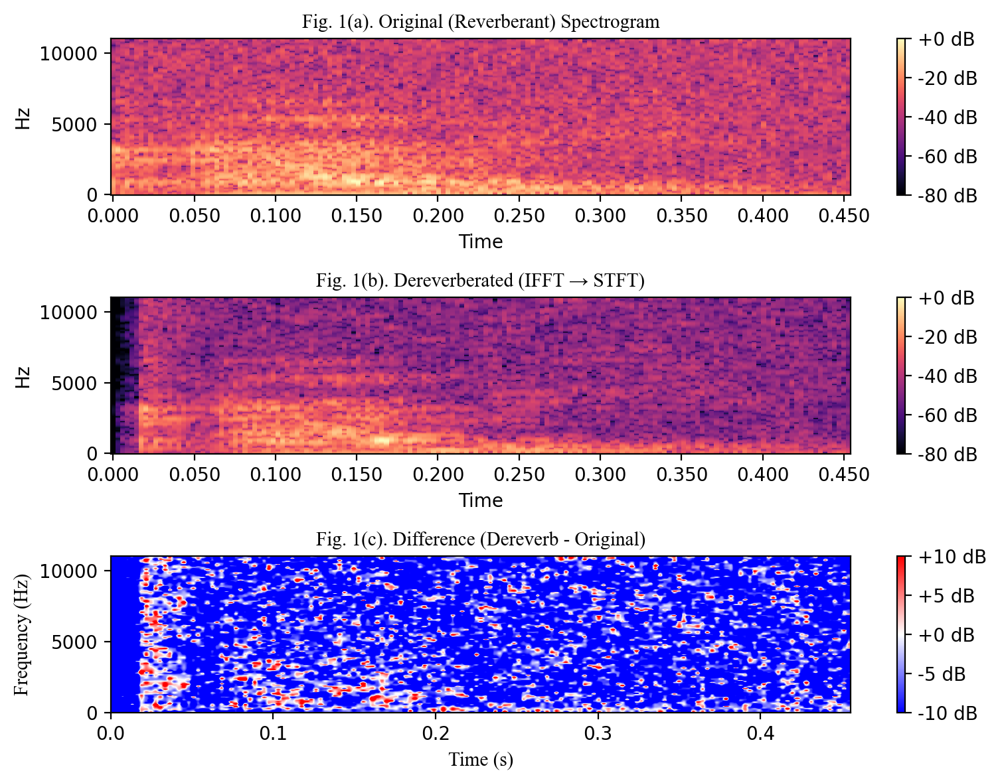

# Robust Time Delay Estimation via Probabilistic Weighting of Parameterized GCC-PHAT on Enhanced Signals

**ICTCA 2025** | **Eojin Kim, Sungbin Im** | Soongsil University

[Previous work: ICEIC 2025](https://github.com/eojinnn/ICEIC-2025) | [Research portfolio](https://github.com/eojinnn/Research-portfolio)

A **lightweight neural time-delay estimation (TDE)** framework for challenging noisy and reverberant conditions, combining **CDR-based signal enhancement**, **parameterized GCC-PHAT**, and **probabilistically weighted CNN features**.

## Motivation

Conventional GCC-PHAT is sensitive to reverberation and noise. A neural model can learn more robust delay patterns, but larger architectures can be costly. This study examines whether correlation-based confidence weighting can help retain useful spatial cues while reducing model complexity.

## Proposed method

**Two microphone signals → DOA-independent CDR enhancement → 11 parameterized GCC-PHAT representations → CNN + correlation-derived confidence weights → predicted time delay**

1. **Signal enhancement:** Estimate the coherent-to-diffuse ratio (CDR) and attenuate diffuse components before estimating inter-microphone delays.
2. **Multi-scale correlation features:** Generate **11** GCC-PHAT representations using PHAT exponents from **0 to 1**.
3. **Probabilistic fusion:** Use correlation-derived weights to modulate CNN features, then regress the time delay.
4. **Compact design:** The reported proposed network has approximately **682K trainable parameters**, compared with **11.5M** in the heavier CDR-masked PGCC comparison.

## Results reported in the paper

Evaluated using simulated acoustic scenes generated with **Pyroomacoustics** and speech from **LibriSpeech**. The paper reports the following MSE comparisons:

| Acoustic condition | PGCC | CDR-masked PGCC | **Proposed** |
| --- | ---: | ---: | ---: |
| SNR 30 dB, T60 0.2 s | 0.88 | 0.44 | **0.16** |
| SNR 0 dB, T60 0.6 s | 0.90 | 0.58 | **0.31** |

**Additional reported results:** overall accuracy (ACC) **0.78** using the paper's time-delay error threshold corresponding to 10 cm. These numbers are **paper-reported simulated results**, not a fresh reproduction from this checkout.

## Repository guide

| Path | Description |
| --- | --- |
| [model.py](model.py) | Parameterized GCC-PHAT, **Probabilistic_PGCCPHAT**, and comparison modules |
| [cdr_dereverb.py](cdr_dereverb.py) | CDR-based two-channel enhancement |
| [estimator.py](estimator.py), [filterbank.py](filterbank.py), [lib.py](lib.py) | Supporting coherence and filtering operations |
| [main.py](main.py) | Experiment and evaluation driver |
| [cfg.py](cfg.py) | Default simulation, network, and training settings |
| [data.py](data.py) | Speech dataset and room simulation |
| [iceic_model.py](iceic_model.py) | Earlier/heavier comparison model |
| [experiments/](experiments/) | Archived experiment configurations and logs |
| [dereverb.ipynb](dereverb.ipynb), [test.ipynb](test.ipynb) | Exploratory notebooks |

## Running experiments

The scripts depend on a local **LibriSpeech** dataset and a Python/PyTorch environment with **torchaudio, pyroomacoustics, NumPy, scipy, librosa**, and other imports used by the scripts.

The default configuration in [cfg.py](cfg.py) selects \`Probabilistic_PGCCPHAT\` and a regression head. An example invocation from the repository root is:

\`\`\`bash
python main.py --exp_name proposed --data_loc /path/to/LibriSpeech
\`\`\`

To evaluate a **previously trained** checkpoint:

\`\`\`bash
python main.py --exp_name proposed --data_loc /path/to/LibriSpeech --evaluate
\`\`\`

**Important limitations:** The code has not been freshly executed or environment-pinned for this README. It contains original local Windows paths in some utilities, and evaluation depends on a matching checkpoint. Check \`main.py\`, \`cfg.py\`, and the dataset configuration before running. Archived log files are not a substitute for a verified reproduction.

## Publication

**Eojin Kim and Sungbin Im**, "Robust Time Delay Estimation via Probabilistic Weighting of Parameterized GCC-PHAT on Enhanced Signals," *16th International Conference on Theoretical and Computational Acoustics (ICTCA)*, Busan, Korea, August 2025.

This work extends the direction explored in [ICEIC 2025](https://github.com/eojinnn/ICEIC-2025) with enhanced signals, parameterized correlation features, and probabilistic weighting.
